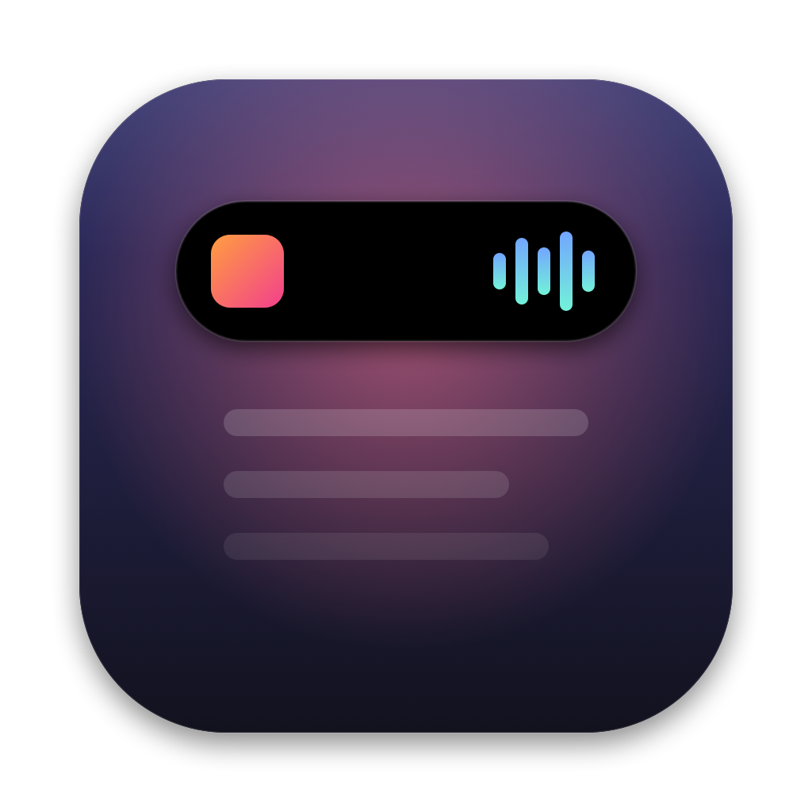
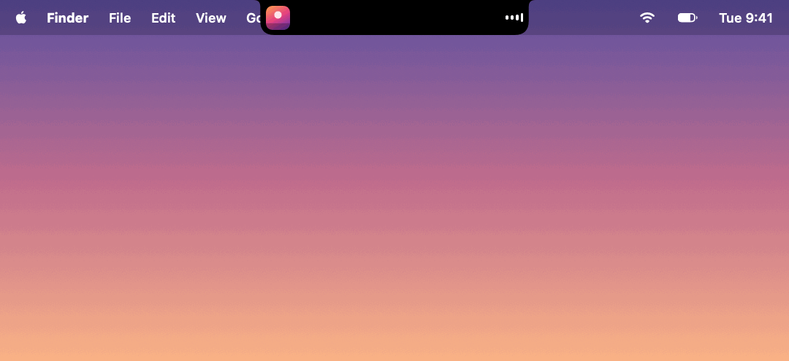

<p align="center">
  
</p>

<h1 align="center">Nook</h1>

<p align="center">
  A free, open-source notch companion for macOS — now playing, system HUD,
  focus timer, tasks, reminders, notes and a file shelf, living in your MacBook's notch.
</p>

<p align="center">
  <a href="https://github.com/siliconile/Nook/releases/latest"></a>
  <a href="https://github.com/siliconile/Nook/actions/workflows/ci.yml"></a>
  
  <a href="LICENSE"></a>
</p>

<p align="center">
  
</p>

---

## Features

**The notch**
- Hover (or click — your choice) the notch to open it; it grows evenly from the centre
  with a soft spring and a feathered blur of the desktop around it.
- Closed "wings" beside the hardware notch show live activity: music, focus timer, alerts.
- Works on Macs without a notch too (draws a menu-bar-height pill).
- Hides automatically when a fullscreen app owns the screen.
- Height adapts to content: Tasks, Reminders and Notes open taller as they fill up.

**Now Playing**
- Track, artist, artwork, progress and play / pause / previous / next.
- Works with **any** player, including web players in browsers (e.g. Chrome),
  Music and Spotify. Click the artwork to jump to the player.
- Compact wings while playing: artwork + animated equalizer tinted from the cover.

**Volume & brightness HUD** (optional)
- Replaces the system volume / brightness overlay with a compact HUD beside the notch.
- Option + Shift + key for fine steps; external outputs without software volume are left to macOS.

**Battery** — charging and unplug alerts, low-battery warning at a threshold you choose.

**Focus timer** — Pomodoro with focus / short / long breaks, session dots, a sound and a
notch alert when a phase ends, and a progress ring in the closed notch while it runs.

**Reminders** — your iCloud Apple Reminders: add, complete, due dates (overdue in red), list colours.

**Tasks** — fast local-first to-do list (saved to `~/Library/Application Support/Nook/tasks.json`).

**Notes** — an instant scratchpad with **live Markdown**: headings, **bold**, *italic*,
`code`, ~~strikethrough~~, quotes, links, smart lists that continue on Return, and
clickable `- [ ]` checkboxes. Saved as you type to `notes.md`.

**Shelf** — drag files onto the notch to park them; drag them back out to any app,
double-click to open, right-click to reveal in Finder.

**Updates** — Nook checks GitHub Releases once a day (can be turned off). **Update Now**
installs the new version and restarts Nook (through `brew upgrade` when installed with
Homebrew); **Check for Updates…** is in the menu-bar menu.

**Languages** — English and Arabic (العربية). Nook follows your system language; to pick a
language just for Nook, use **System Settings → General → Language & Region → Applications**.

**Settings** — launch at login, hover vs. click to open, hover delay, default tab when
nothing is playing, per-module toggles, timer lengths, low-battery threshold.

## Install

### Homebrew

```bash
brew install --cask siliconile/tap/nook-notch
```

The cask clears the quarantine flag after installing, so Nook opens without the
"Apple could not verify" prompt. Update with `brew upgrade --cask nook-notch`.

### Manual

1. Download **Nook-x.y.z.zip** from the [latest release](https://github.com/siliconile/Nook/releases/latest) and unzip it.
2. Move **Nook.app** to **Applications** and open it.
3. Nook isn't notarized by Apple yet, so the first launch is blocked. Open
   **System Settings → Privacy & Security**, scroll down and click **Open Anyway**
   — or run:

   ```bash
   xattr -dr com.apple.quarantine /Applications/Nook.app
   ```

Works on Apple silicon and Intel Macs running macOS 15 or later. Each release ships a
`.sha256` file to verify the download.

## Requirements (building from source)

- macOS 15 (Sequoia) or later, Apple silicon or Intel
- Xcode command line tools / Swift 6 toolchain (`xcode-select --install`)

## Build & run

```bash
git clone https://github.com/siliconile/Nook.git && cd Nook
./build.sh            # release build -> build/Nook.app
open build/Nook.app
```

`./build.sh debug` builds a debug version; `./build.sh release --universal` builds for
both Apple silicon and Intel. To install, drag `build/Nook.app` into
`/Applications`. Nook lives in the menu bar (no Dock icon); use its menu-bar icon for
**Settings…** and **Quit**.

After rebuilding, restart the running copy:

```bash
pkill -x Nook; open build/Nook.app
```

## Permissions

| Feature | Permission | When it's asked |
| --- | --- | --- |
| Volume / brightness HUD | Accessibility | When you click **Grant…** in Settings |
| Reminders | Reminders (full access) | First launch with Reminders enabled |
| Spotify / Music fallback | Automation | Only if the system-wide source is unavailable |

Builds are signed ad-hoc with a fixed designated requirement (`identifier "io.github.siliconile.Nook"`),
so permissions survive rebuilds. If a permission ever looks "on" but doesn't work
(e.g. after changing the bundle identifier), remove Nook from that list in
**System Settings → Privacy & Security** and grant it again.

## Troubleshooting

- **Nook stopped responding** — it's a menu-bar app, so it doesn't appear in
  *Force Quit Applications*. Quit it from **Activity Monitor** (search "Nook" → ✕), or run
  `pkill -x Nook`, then open it again.
- **A permission looks enabled but the feature doesn't work** — remove Nook from that list in
  **System Settings → Privacy & Security** and grant it again.

## How it works

- **Notch window** — a borderless, non-activating `NSPanel` above the menu bar on every
  Space. Hover/click detection uses global mouse monitors, so no extra permission is needed.
  The outline is one animatable shape driven by a single progress value, so width, height and
  corners always move together.
- **Now Playing** — since macOS 15.4 the private MediaRemote framework only answers
  Apple-signed processes. Nook ships a tiny helper library (`Helper/NookMediaBridge.m`)
  that is loaded by the system's `/usr/bin/perl` (an Apple platform binary) and streams
  now-playing changes as JSON lines; commands are sent the same way. If that isn't
  available, Nook falls back to AppleScript for Spotify and Music.
  **Settings → Now Playing** shows which source is active. Apple has deprecated bundled
  scripting runtimes; if a future macOS drops `/usr/bin/perl`, the fallback keeps Music and
  Spotify working while a replacement bridge is built.
- **HUD** — a `CGEventTap` on media keys; volume via CoreAudio, brightness via DisplayServices.
- **Battery** — IOKit power-source notifications.

## Project layout

```
Sources/Nook/
  App/        AppDelegate (menu bar item, Edit menu), Snapshot (debug renderer)
  Core/       NookState (single source of truth), NotchWindowController, Pref
  UI/         NotchRootView, NotchSilhouette, Theme (design tokens), SettingsView
  Modules/    NowPlaying, HUD, Battery, Pomodoro, Reminders, Tasks, Notes, Shelf
Helper/       NookMediaBridge.m (Now Playing bridge, built by build.sh)
Resources/    Info.plist, entitlements, AppIcon.icns
Tools/        make-icon.swift (regenerates the app icon)
```

### Developer tips

- `.build/debug/Nook --snapshot <dir>` renders every notch state to PNG files — handy for
  checking layouts without Screen Recording permission.
- `.build/debug/Nook --demo-gif docs/demo.gif` re-renders the README demo from the real
  views with sample data.
- Design tokens (sizes, spacing, animation timing, blur) live in `Sources/Nook/UI/Theme.swift`.
- `swift Tools/make-icon.swift` regenerates `docs/icon.png` and `Resources/AppIcon.icns`.

## Contributing

Issues, ideas and pull requests are welcome! Start with [CONTRIBUTING.md](CONTRIBUTING.md)
(setup, project structure, how to add a module), and please follow the
[Code of Conduct](CODE_OF_CONDUCT.md). Security issues: see [SECURITY.md](SECURITY.md).
Release notes live in [CHANGELOG.md](CHANGELOG.md).

## License

[MIT](LICENSE) — free to use, modify and distribute.

Nook is an independent project, inspired by the iPhone's Dynamic Island. It is not
affiliated with Apple or with any other notch app.
